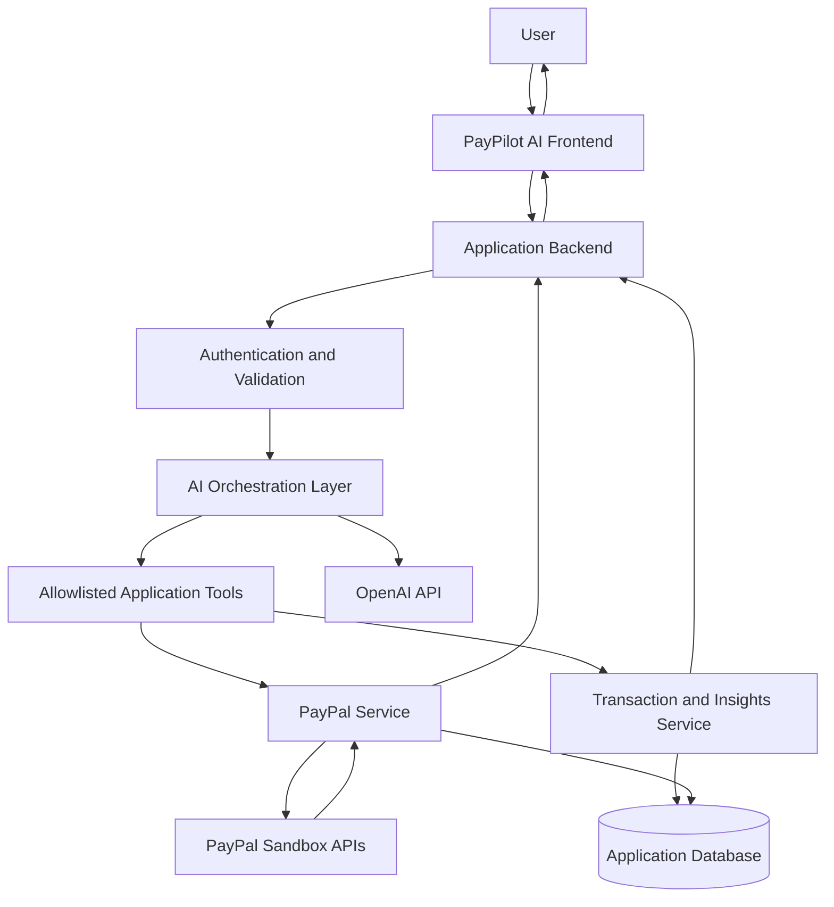
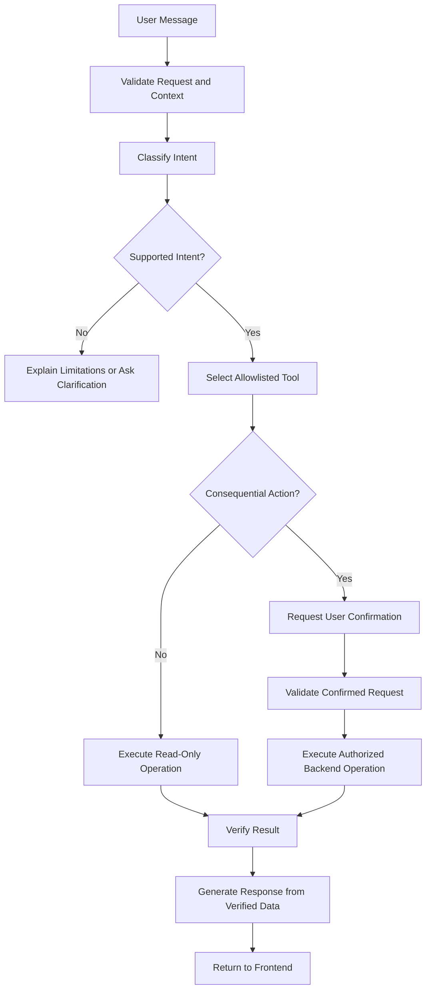

# PayPilot AI — Master Project Blueprint, Architecture & LLM Handoff

**Document purpose:** Canonical reference for the PayPal hackathon project. This document explains the product vision, proposed features, system architecture, security requirements, PayPal integration, current progress, known blockers, implementation roadmap, and rules for future AI coding agents.

**Project name:** PayPilot AI
**Project category:** AI-powered fintech, intelligent payments, agentic commerce
**Primary payment platform:** PayPal
**Development environment:** Replit
**Payment environment:** PayPal Sandbox only during development and hackathon testing
**Project status:** Implemented prototype, audited on 2026-10-25. **The real PayPal Sandbox round-trip is not yet verified** (it has only run against a simulator). The authoritative, evidence-graded status is `docs/IMPLEMENTATION_STATUS.md`; this document is the intended specification plus a verified-facts section (§4).

---

# 1. Executive Summary

PayPilot AI is an AI-powered payment and financial assistance platform designed to make digital payments easier to understand, safer to complete, and more useful to users and merchants.

The product combines conversational AI, payment workflows, transaction intelligence, and contextual financial assistance. Rather than acting only as a conventional payment checkout, PayPilot AI aims to provide an intelligent interface that helps users understand payment-related information and complete supported payment workflows through PayPal.

The central idea is to connect an AI assistant with real, verifiable payment operations while keeping financial actions controlled by secure backend services.

The project is being developed for a PayPal hackathon. Its success depends on demonstrating a working product, meaningful use of PayPal capabilities, a clear user problem, a reliable end-to-end workflow, and a convincing live demo.

## Core product pillars

1. **AI Payment Agent:** Understand payment-related questions and guide users through appropriate actions.
2. **Intelligent Checkout Agent:** Create PayPal orders, facilitate Sandbox checkout, and verify completed payments.
3. **Transaction Intelligence:** Present and explain available transaction information.
4. **Spending Intelligence:** Categorize available transaction data and provide useful summaries.
5. **International Payment Assistant:** Help users understand supported currencies, conversion considerations, and payment costs where reliable data is available.

These are the intended product capabilities. Their actual implementation status must be confirmed from the repository.

---

# 2. Problem Statement

Digital payment experiences can be fragmented. Users may have difficulty understanding payment statuses, finding transaction information, resolving payment problems, and determining what to do next.

Merchants and developers also need to integrate payment processing with application workflows, handle errors correctly, and provide clear feedback after a payment.

A conversational interface can simplify these interactions, but an AI model alone cannot reliably authorize, create, or verify financial transactions.

PayPilot AI addresses this gap by separating conversational intelligence from payment execution.

## Proposed solution

The user interacts with a unified dashboard and AI assistant. The assistant interprets the request and, when appropriate, invokes a controlled backend workflow. The backend communicates with PayPal APIs, validates the result, and returns verified information to the user interface.

For example:

- A user asks how to pay for an order.
- The application creates a PayPal Sandbox order on the server.
- The user completes checkout through PayPal's supported approval experience.
- The backend captures the approved order.
- The application verifies the result and displays the confirmed payment status.

The same principle applies to transaction explanations and other future capabilities: the AI can explain available information, but factual financial results must come from authoritative data.

---

# 3. Project Scope and Feature Inventory

## 3.1 AI Payment Agent

**Objective:** Provide a conversational interface for payment-related assistance.

Planned capabilities:

- Understand natural-language payment requests.
- Explain payment statuses and common errors.
- Guide users through supported checkout workflows.
- Explain the next step when a payment is pending, approved, failed, or completed.
- Provide contextual assistance based on verified application data.
- Route supported requests to backend tools instead of inventing payment results.

**Important boundary:** The AI must not claim that a payment succeeded simply because it generated a response. Payment status must be established by the backend.

## 3.2 Intelligent Checkout Agent

**Objective:** Demonstrate a genuine PayPal integration.

Planned capabilities:

- Create a PayPal order using the server-side Orders API.
- Return the necessary checkout information to the frontend.
- Let the user approve payment through PayPal's supported checkout flow.
- Capture the approved order through the backend.
- Verify the capture response.
- Display the final payment state.
- Handle cancellation, duplicate requests, API failures, and incomplete checkout.

This is a core demonstration candidate because it provides an observable end-to-end payment workflow.

## 3.3 Transaction Intelligence

**Objective:** Help users understand available transaction records.

Planned capabilities:

- Display transaction history when a suitable data source is integrated.
- Explain payment amounts, currencies, dates, and statuses.
- Search or filter transactions.
- Summarize transaction information.
- Explain errors or pending states using verified records.

**Data limitation:** Creating PayPal Sandbox orders does not automatically provide a user's complete PayPal consumer transaction history. Access to historical data depends on the specific supported API, permissions, account context, and integration.

If historical data is unavailable, the MVP must use clearly labelled application transactions or seeded demonstration records rather than pretending to access a real consumer account.

## 3.4 Spending Intelligence

**Objective:** Convert available transaction data into useful summaries.

Planned capabilities:

- Group transactions into categories.
- Calculate totals for a selected time period.
- Display spending trends.
- Summarize recurring transaction patterns when sufficient data exists.
- Explain how totals were calculated.

The categorization and insights engine can begin with deterministic rules. AI can be added for explanations and ambiguous categories, with the original transaction values preserved.

## 3.5 International Payment Assistant

**Objective:** Explain international payment considerations.

Planned capabilities:

- Explain supported currency options.
- Display currency information obtained from a reliable source.
- Explain applicable fees when authoritative fee information is available.
- Help users understand the implications of a currency choice.

Currency conversion rates and fees must not be fabricated. If current rates or account-specific fees cannot be retrieved, the interface must say so.

International payment execution is an optional extension, not a requirement for the initial working checkout.

---

# 4. Current Progress: Confirmed Facts Versus Unverified Work

This section is critical for future LLMs.

## Confirmed from the project discussions

- The project is named **PayPilot AI**.
- It is a separate PayPal hackathon project.
- Replit is the development environment.
- The integration is intended to use PayPal Sandbox credentials.
- The required environment variables discussed are:
  - `OPENAI_API_KEY`
  - `PAYPAL_CLIENT_ID`
  - `PAYPAL_CLIENT_SECRET`
  - `PAYPAL_MERCHANT_ID`
- The user encountered an “Unauthorized” page while attempting to access PayPal developer resources or account information.
- Obtaining or confirming the expected receiving Sandbox merchant ID remains part of the setup investigation.
- The product vision includes an AI payment assistant, checkout, transaction intelligence, spending intelligence, and international payment assistance.

## Verified on 2026-10-25 (from the repository, not from the plan)

Evidence levels: **RUN** = executed against the real server and database; **SIM** = executed against an in-process PayPal simulator (proves PayPilot's logic, not real PayPal); **CODE** = read only.

| Question from the original list | Verified answer | Evidence |
|---|---|---|
| Frontend framework and pages | React 19 + Vite + Tailwind 4 + wouter + TanStack Query; seven pages in one `App.tsx` (Overview, AI assistant, Demo checkout, Transactions, Analytics, International, Settings) | RUN |
| Backend framework and routes | Express 5 under `/api` (see IMPLEMENTATION_STATUS §5 for the real route list) | RUN |
| OpenAI integration | Present: Chat Completions with four read-only tools and a labelled deterministic fallback. Live model path untested (no key). | RUN (fallback) / CODE |
| AI tool-calling workflow | Present but **read-only**: catalog, transactions, spending, FX. It cannot create or capture orders. | CODE |
| PayPal order creation | Implemented; verified against a simulator only | SIM |
| Order capture | Implemented; verified against a simulator only, including duplicate and concurrent requests | SIM |
| Payment status verification | Implemented (order, capture, exact amount, currency and payee must all match) | SIM |
| Merchant ID confirmed | **No.** It is only an expected value compared with `payee.merchant_id`. Use Settings → *Run PayPal Sandbox check* to confirm it. | SIM |
| Transaction dashboard on live API data | **No.** Synthetic seeded records (labelled) plus PayPilot-created orders. No PayPal history API. | RUN |
| Database | PostgreSQL + Drizzle; one table, `paypilot_orders` | RUN |
| Authentication | **None** | CODE |
| Automated tests | None existed; 32 unit and 29 end-to-end checks added on 2026-10-25 | RUN |
| Deployment configuration | Replit artifact configs (`artifact.toml`), autoscale deployment in `.replit` | CODE |

Confirmed facts carried over: the project is PayPilot AI; Replit is the environment; Sandbox only; the environment variables are `OPENAI_API_KEY`, `PAYPAL_CLIENT_ID`, `PAYPAL_CLIENT_SECRET`, `PAYPAL_MERCHANT_ID` (plus `PAYPAL_ENVIRONMENT=sandbox`, preset in `.replit`, and optional `OPENAI_MODEL`); the "Unauthorized" PayPal dashboard page remains an open, user-side issue.

---

# 5. High-Level System Architecture

The proposed architecture separates the frontend, AI orchestration, application backend, payment integration, and data storage.



This diagram is the target architecture, not proof that all components currently exist.

## Component responsibilities

### A. Frontend

Responsible for:

- Dashboard and navigation.
- Chat interface.
- Checkout initiation and approval experience.
- Payment status display.
- Transaction list and summaries.
- Loading states, errors, and empty states.
- Clear distinction between simulated and verified information.

The frontend must never contain the PayPal client secret or another server-only credential.

### B. Application backend

Responsible for:

- Validating requests.
- Managing application sessions and user context.
- Calling the OpenAI API from a secure server environment.
- Invoking allowlisted tools.
- Creating and capturing PayPal orders.
- Validating payment state.
- Returning structured responses to the frontend.
- Recording appropriate application events and transaction metadata.

### C. AI orchestration layer

Responsible for:

- Interpreting natural-language requests.
- Selecting from permitted application tools.
- Providing verified context to the language model.
- Formatting responses and explanations.
- Asking for clarification when required.
- Requesting user approval before consequential actions.

The AI must not directly call arbitrary URLs, execute unrestricted code, or independently decide that a financial action succeeded.

### D. PayPal integration service

Responsible for:

- Obtaining OAuth access tokens using Sandbox credentials.
- Creating orders.
- Supporting the approval flow.
- Capturing approved orders.
- Parsing PayPal responses.
- Handling API errors and timeouts.
- Confirming final payment state.
- Preventing duplicate capture operations where possible.

### E. Data layer

A database may be used to store application users, internal order mappings, payment records, AI interaction metadata, and transaction categorization results.

The actual database technology must be determined by inspecting the current repository. Do not introduce a new database unless the existing application requires one.

---

# 6. Suggested Backend Modules

> **Actual layout (2026-10-25):** pnpm monorepo. `artifacts/api-server` (Express), `artifacts/paypilot-ai` (React), `lib/db` (Drizzle), `lib/api-spec` + generated `lib/api-client-react` / `lib/api-zod`. The PayPal client is `artifacts/api-server/src/lib/paypal-sandbox.ts`. The tree below is illustrative only.

The following is a logical organization. Adapt it to the existing codebase rather than forcing these exact filenames.

```text
paypilot-ai/
├── frontend/
│   ├── pages-or-routes/
│   ├── components/
│   ├── chat/
│   ├── checkout/
│   ├── dashboard/
│   └── transaction-ui/
│
├── backend/
│   ├── api/
│   │   ├── chat
│   │   ├── orders
│   │   ├── payments
│   │   ├── transactions
│   │   └── insights
│   │
│   ├── services/
│   │   ├── ai-orchestrator
│   │   ├── paypal-client
│   │   ├── order-service
│   │   ├── payment-verification
│   │   ├── transaction-service
│   │   └── insights-service
│   │
│   ├── middleware/
│   │   ├── validation
│   │   ├── authentication
│   │   └── error-handling
│   │
│   └── configuration/
│
├── shared/
│   ├── types-or-schemas/
│   └── constants/
│
├── tests/
│   ├── ai/
│   ├── checkout/
│   ├── payments/
│   └── api/
│
├── documentation/
│   └── architecture-and-handoff.md
│
├── .env.example
├── dependency-manifest
└── README.md
```

The directory names are illustrative. A React, Next.js, Express, Flask, or other existing stack may use a different organization. The LLM must identify the real stack before proposing concrete file changes.

---

# 7. PayPal Integration Architecture

## 7.1 Sandbox configuration

The application is intended to use these environment variables:

| Variable | Purpose |
|---|---|
| `OPENAI_API_KEY` | Server-side access to the selected OpenAI API |
| `PAYPAL_CLIENT_ID` | PayPal Sandbox application identifier |
| `PAYPAL_CLIENT_SECRET` | Secret used for server-side OAuth authentication |
| `PAYPAL_MERCHANT_ID` | Expected receiving Sandbox merchant identifier, subject to verification |

Store actual values in Replit Secrets or the equivalent secure environment configuration.

The `.env.example` file should contain placeholder values only. Never commit actual credentials.

## 7.2 Sandbox API base URL

Use the Sandbox API environment during development:

`https://api-m.sandbox.paypal.com`

Do not silently switch to the live API. A production migration would require a separate, explicit review of credentials, merchant configuration, permissions, testing, and security.

## 7.3 Authentication flow

The backend should:

1. Read the Sandbox Client ID and Client Secret from secure environment variables.
2. Request an OAuth access token from PayPal's Sandbox token endpoint.
3. Cache the token for its valid lifetime where appropriate.
4. Refresh it when necessary.
5. Use the token for authenticated PayPal API requests.
6. Handle authentication failures without exposing credentials or token contents to the user.

## 7.4 Order creation flow

1. The user chooses an item or amount within the application.
2. The backend validates the request.
3. The backend determines the allowed amount and currency using trusted application data.
4. The backend creates a PayPal order with the Orders API.
5. The backend records the internal order reference and PayPal order ID.
6. The frontend receives the necessary checkout information.
7. The user approves the payment using PayPal's supported checkout experience.

Never trust a frontend-supplied amount without server-side validation.

## 7.5 Order capture flow

1. The frontend submits the relevant PayPal order ID to the backend after approval.
2. The backend confirms that the order belongs to the expected application context.
3. The backend verifies the current order state and expected amount.
4. The backend captures the approved order using PayPal's API.
5. The backend validates the capture response and relevant status fields.
6. The backend records the verified result.
7. The frontend displays the resulting status.

A user returning from the approval page is not sufficient evidence that the payment was captured.

## 7.6 Payment states

The application should represent payment states explicitly, for example:

- `CREATED`
- `PENDING_APPROVAL`
- `APPROVED`
- `CAPTURE_PENDING`
- `COMPLETED`
- `FAILED`
- `CANCELLED`
- `UNKNOWN`

These are proposed internal states, not necessarily identical to PayPal's raw status values.

Map the actual PayPal response to internal states carefully. Do not convert an unknown or pending response into `COMPLETED`.

## 7.7 Duplicate requests and reliability

The implementation should consider:

- Repeated user clicks.
- Browser refreshes.
- Network timeouts.
- Capture requests retried after an uncertain response.
- Orders approved but not captured.
- Orders that have already been captured.
- Mismatched amounts or currencies.
- Invalid or unexpected order IDs.

Use supported idempotency mechanisms where available, and reconcile uncertain operations against PayPal's actual order and capture state before retrying.

---

# 8. AI Agent Design

The AI should be a controlled orchestration layer, not an unrestricted payment executor.

## 8.1 Request-processing flow



## 8.2 Initial tool set

Potential tools include:

- `get_payment_status`
- `create_checkout_order`
- `capture_approved_order`
- `list_available_transactions`
- `summarize_transactions`
- `categorize_transactions`
- `explain_payment_error`

These names are proposals for application functions, not confirmed existing tools.

Each tool must have:

- A defined input schema.
- Input validation.
- An authorization policy.
- A bounded purpose.
- A documented output schema.
- Error handling.
- Appropriate logging.
- Tests for normal and abnormal conditions.

## 8.3 AI safety rules

- Never reveal API keys, access tokens, or secrets.
- Never fabricate transaction records, payment statuses, exchange rates, or fees.
- Never claim to have executed a payment unless the backend confirms it.
- Never allow the model to set an arbitrary amount or recipient without validation.
- Never expose one user's transaction information to another user.
- Never permit arbitrary model-generated SQL or unrestricted API requests.
- Require clear user confirmation for consequential actions.
- Treat external API content and user-supplied content as untrusted data.
- Provide useful fallback responses when the AI service is unavailable.

---

# 9. Data Model

The following is a suggested logical model. Actual tables and fields should be adapted to the existing persistence layer.

## User

- Internal user ID.
- Authentication identifier, if authentication exists.
- Created timestamp.
- Application preferences, if required.

Do not store payment credentials unnecessarily.

## Order

- Internal order ID.
- PayPal order ID.
- Internal user or session reference.
- Amount.
- Currency.
- Order state.
- Creation timestamp.
- Last updated timestamp.

## Payment or capture record

- Internal payment ID.
- Associated order ID.
- PayPal capture ID, when available.
- Captured amount.
- Currency.
- Verified status.
- Capture timestamp, when available.
- Relevant error code or safe diagnostic metadata.

## Transaction

- Transaction identifier.
- Source system.
- Amount and currency.
- Date.
- Status.
- Description or merchant information, when available.
- Category, if assigned.
- Provenance indicating whether the record is a verified Sandbox transaction, imported record, or demonstration fixture.

## AI interaction metadata

If needed, record:

- Request identifier.
- Intent classification.
- Tool name.
- Operation outcome.
- Timestamp.
- Safe error metadata.

Avoid retaining unnecessary sensitive conversation content or payment information.

---

# 10. API Design

> **Actual routes differ from the table below.** For example the real endpoints are `/api/healthz`, `/api/checkout/orders`, `/api/checkout/orders/:orderId/capture`, `/api/assistant`, `/api/analytics/spending`, and `/api/settings/paypal-check`. See `docs/IMPLEMENTATION_STATUS.md` §5 for the verified map.

These are proposed application endpoints. They must be reconciled with existing routes before implementation.

| Method | Example endpoint | Responsibility |
|---|---|---|
| POST | `/api/chat` | Process a conversational request |
| POST | `/api/orders` | Create a validated PayPal order |
| POST | `/api/orders/:id/capture` | Capture an approved order |
| GET | `/api/orders/:id` | Return verified order status |
| GET | `/api/transactions` | List available transaction records |
| GET | `/api/insights/summary` | Return calculated transaction summaries |
| GET | `/api/health` | Check application health without exposing secrets |

All endpoints must validate input and use consistent error handling.

Read and write endpoints must enforce appropriate access controls. A public-facing application must not let a user access another user's order merely by guessing an order ID.

The health endpoint should return operational status only, not environment-variable values.

---

# 11. Dashboard and User Experience

The intended interface can contain the following sections, subject to the current application's existing design.

## A. Home dashboard

- Welcome section.
- AI assistant entry point.
- Checkout or payment action.
- Recent application transactions.
- Summary metrics based on available data.
- Clear connection or error indicators.

## B. AI assistant

- Chat history within the permitted retention policy.
- Suggested questions.
- Tool execution status where useful.
- Payment confirmation prompts.
- Verified answers with appropriate source context.

## C. Checkout

- Item or payment summary.
- Currency and amount.
- PayPal approval experience.
- Cancel and error states.
- Confirmation after verified capture.

## D. Transactions

- Transaction list.
- Status and date.
- Amount and currency.
- Filters and search.
- Clear labelling of Sandbox, imported, or sample data.

## E. Insights

- Spending by category.
- Total spending for a selected period.
- Transaction counts.
- Explanations for computed totals.
- Empty states when insufficient data exists.

## UX requirement

The application should make the difference between **AI-generated guidance**, **application-calculated information**, and **PayPal-verified payment results** understandable to users.

---

# 12. Security, Privacy, and Compliance Considerations

Security must be built into the initial implementation, not postponed until after the demo.

### Secrets and credentials

- Keep API credentials in server-side environment variables.
- Never expose the PayPal Client Secret or OpenAI API key in browser bundles.
- Never paste actual secrets into prompts, documentation, public issues, or source control.
- Redact credentials and tokens from application logs.

### Payment integrity

- Validate amounts and currencies on the backend.
- Verify order ownership and application context.
- Confirm final payment state with PayPal.
- Handle retries and duplicate operations safely.
- Do not rely solely on frontend callbacks or redirects.
- Validate webhook signatures if webhooks are introduced.

### User data

- Limit access to transaction records.
- Collect only data needed for the feature.
- Avoid storing payment card details.
- Avoid unnecessary storage of personal financial data.
- Keep demonstration records clearly separated from actual payment records.
- Use synthetic data for screenshots and demos unless real data access is authorized and necessary.

### Error handling

- Show user-friendly error messages.
- Keep detailed diagnostics server-side.
- Do not return raw stack traces, OAuth tokens, or confidential API responses to the frontend.

### Production boundary

This project is being developed with Sandbox payments. A working Sandbox demo does not establish production readiness, regulatory compliance, or permission to handle live financial transactions.

---

# 13. Current Blocker: PayPal Developer Dashboard Shows Unauthorized

The known setup issue is an “Unauthorized” page encountered while accessing PayPal developer resources or account information.

This does not, by itself, prove that the API credentials are invalid or that the application is broken.

## Troubleshooting sequence

1. Open the official [PayPal Developer Dashboard](https://developer.paypal.com/dashboard/).
2. Sign in using the account intended to manage the Sandbox application.
3. Check the [Sandbox Applications page](https://developer.paypal.com/dashboard/applications/sandbox).
4. Check the [Sandbox Accounts page](https://developer.paypal.com/dashboard/accounts).
5. Confirm that the expected Sandbox application and business test account are available.
6. If the page remains unauthorized, investigate account session, access permissions, application access, or a PayPal dashboard issue.
7. If credentials are already available, test them using a server-side Sandbox OAuth request.
8. Verify the receiving Sandbox merchant ID from the appropriate account details and integration requirements.

**Merchant ID caution:** Do not assume that the Client ID, email address, PayPal order ID, and receiving merchant ID are interchangeable. Confirm the identifier expected by the integration.

The next coding agent should diagnose the actual error before changing credentials, replacing configuration, or rewriting the integration.

**Update 2026-10-25:** the dashboard "Unauthorized" page is a PayPal website access problem and cannot be fixed from this codebase. The application can now diagnose credentials and merchant ID **without the dashboard**: `POST /api/settings/paypal-check` (Settings → *Run PayPal Sandbox check*) reports `not_configured`, `auth_failed`, `merchant_mismatch` (with masked IDs), `merchant_unavailable`, `paypal_error`, `network_error` or `ok`. `PAYPAL_MERCHANT_ID` is not sent to PayPal; it is compared against the payee PayPal returns, so it must be the Account ID of the Sandbox business account the REST app is attached to.

---

# 14. MVP Definition

The first release should prioritize a small, demonstrably functional product over a large collection of incomplete features.

## Required MVP capabilities

1. Existing application starts successfully in Replit.
2. AI assistant accepts a request and returns a useful response.
3. PayPal Sandbox credentials are loaded securely.
4. The backend can authenticate with PayPal.
5. The backend can create a valid Sandbox order.
6. The user can approve checkout through PayPal.
7. The backend can capture the approved order.
8. The application displays the verified final payment state.
9. Transaction or payment records can be displayed accurately.
10. Important failures and cancellation cases are handled.
11. The demo can be repeated without manually repairing application state.

## Stretch features

After the core payment workflow works:

- AI-assisted transaction explanations.
- Spending categorization and summaries.
- Richer payment troubleshooting.
- Currency information.
- Transaction search.
- Additional AI tools.
- Webhook-based payment updates.
- More advanced dashboard visualizations.

The actual hackathon requirements and judging rubric must be checked before finalizing feature priorities.

---

# 15. Testing Strategy

## PayPal integration tests

- Valid OAuth authentication.
- Invalid credential handling.
- Order creation.
- Order approval.
- Successful capture.
- Cancelled checkout.
- Failed capture.
- Repeated capture requests.
- Unknown order ID.
- Incorrect amount or currency.
- Network timeout and recovery.

## AI tests

- Ordinary payment question.
- Unsupported request.
- Request for a payment status that does not exist.
- Request to execute a consequential action without confirmation.
- Malicious instruction attempting to reveal secrets.
- Tool error during a conversation.
- Missing transaction history.
- Incorrect or incomplete context.

## Frontend tests

- Loading indicators.
- Checkout approval and cancellation.
- Payment status updates.
- Error messages.
- Empty transaction list.
- Responsive layout.
- Duplicate button clicks.
- Page refresh during a pending operation.

## End-to-end acceptance test

A judge should be able to open the application, ask for help, initiate a Sandbox checkout, approve it, and see a verified payment result. The application should also explain the outcome conversationally without fabricating information.

---

# 16. Hackathon Demo Plan

Suggested demo sequence:

**Part 1 — Introduce the problem**

Explain how PayPilot AI brings conversational assistance and verifiable payment operations into a unified experience.

**Part 2 — Show the assistant**

Ask a realistic payment-related question and demonstrate how the assistant identifies the request and responds.

**Part 3 — Execute a real Sandbox workflow**

Create an order, approve it through PayPal Sandbox, capture it on the backend, and display the verified result.

**Part 4 — Show transaction intelligence**

Display the resulting application transaction and explain its status. Demonstrate spending insights only if the required data and calculations are actually implemented.

**Part 5 — Explain the technical differentiator**

Show the separation between the AI orchestration layer and the secure payment service, including server-side validation and verified payment state.

**Part 6 — Explain future potential**

Describe how additional transaction insights, payment assistance, and supported international payment guidance could extend the same architecture.

Do not simulate a successful payment while claiming it was processed by PayPal. If a feature is mocked, label it as a demonstration.

---

# 17. Implementation Roadmap

**Status on 2026-10-25**

| Phase | Status |
|---|---|
| 0 Repository audit | **Done** (`docs/IMPLEMENTATION_STATUS.md`) |
| 1 Resolve configuration | **Tooling done; credentials are the user's task.** Real Sandbox authentication is unverified until the check in Settings reports `ok`. |
| 2 Payment workflow | **Implemented and simulator-verified.** Not verified on real PayPal. Token caching, a persisted `cancelled` state and `GET /orders/:id` remain. |
| 3 AI integration | **Partial.** Read-only tools only; no confirmation-gated payment tools; PayPal Agent Toolkit/MCP not used. |
| 4 Transaction intelligence | **Partial.** Works on labelled synthetic data plus app orders. |
| 5 Polish and validate | **Not started** (see the defect list in the status report). |

## Phase 0 — Repository audit

- Inspect the full project structure.
- Identify the frontend and backend stacks.
- Review dependency manifests and entry points.
- Identify existing API routes and components.
- Locate environment-variable references.
- Run the existing project.
- Record current errors.
- Preserve working features.

**Deliverable:** A repository audit and accurate implementation-status report.

## Phase 1 — Resolve configuration

- Investigate the PayPal dashboard authorization issue.
- Confirm Sandbox application credentials.
- Confirm the receiving Sandbox merchant ID.
- Configure Replit Secrets.
- Test backend OAuth authentication.
- Verify that secrets remain server-side.

**Deliverable:** Successful Sandbox authentication.

## Phase 2 — Complete the payment workflow

- Implement or repair order creation.
- Implement the PayPal approval experience.
- Implement server-side capture.
- Validate the final payment status.
- Persist or reliably retrieve order state.
- Handle cancellation, failures, and duplicate requests.

**Deliverable:** Repeatable end-to-end Sandbox checkout.

## Phase 3 — Integrate AI

- Connect the existing OpenAI integration or add one if absent.
- Build the controlled orchestration layer.
- Define the initial tool schemas.
- Connect AI responses to verified application data.
- Add confirmation and error-handling logic.

**Deliverable:** AI assistant connected to real application capabilities.

## Phase 4 — Add transaction intelligence

- Display available transaction records.
- Add transaction search and status explanations.
- Calculate summaries from real records.
- Add categorization and insights where feasible.

**Deliverable:** Useful transaction dashboard with traceable data.

## Phase 5 — Polish and validate

- Improve UI consistency.
- Test all important payment states.
- Verify mobile and desktop behavior.
- Remove broken or misleading controls.
- Prepare repeatable demo data and instructions.
- Document limitations and remaining work.

**Deliverable:** A reliable hackathon-ready application.

---

# 18. Rules for Future LLMs and Coding Agents

Any LLM continuing this project must follow these rules.

1. **Inspect before editing.** Read the existing files and identify the real application stack.
2. **Preserve existing work.** Do not replace the project with a new template merely because the architecture above is presented.
3. **Maintain one canonical project.** Consolidate changes into the existing project instead of creating competing implementations.
4. **Separate fact from plan.** Do not mark a feature as complete until it has been verified.
5. **Use Sandbox only.** Never switch to live PayPal credentials without explicit authorization and a separate deployment review.
6. **Protect all secrets.** Never ask the user to paste API secrets into chat or commit them to the repository.
7. **Make incremental changes.** Identify the files being changed and explain why.
8. **Test actual workflows.** A successful build is not proof that checkout works.
9. **Use verified payment state.** Do not infer successful capture from AI text or browser navigation.
10. **Avoid unnecessary complexity.** Complete the core checkout workflow before adding optional agents, databases, and integrations.
11. **Preserve backward compatibility.** Review existing behavior before changing routes, dependencies, schemas, or environment variables.
12. **Report blockers honestly.** If access to PayPal, credentials, or a third-party service prevents testing, describe what was and was not verified.
13. **Update this document.** Record significant implementation changes and the results of end-to-end tests.

---

# 19. Definition of Done

PayPilot AI is ready for the hackathon demonstration when:

- [x] The existing application runs reliably. *(Builds, boots, typechecks and passes its tests locally, 2026-10-25. Re-confirm in Replit.)*
- [ ] All required credentials are configured securely. *(Unknown: Replit Secrets are not visible to the audit. Run the Settings check.)*
- [ ] PayPal Sandbox authentication succeeds. *(Unverified on real PayPal.)*
- [ ] Order creation succeeds. *(Simulator only.)*
- [ ] Checkout approval works. *(Redirect and return handling verified in a browser against the simulator; real approval untested.)*
- [ ] Server-side capture succeeds. *(Simulator only.)*
- [ ] Final payment state is verified. *(Logic verified against the simulator; not against real PayPal.)*
- [ ] The frontend displays accurate payment information. *(Verified for simulator responses only.)*
- [ ] The AI assistant provides useful, grounded responses. *(Fallback verified; live OpenAI path untested.)*
- [ ] Error and cancellation flows work. *(Verified against the simulator; cancellation is not persisted server-side.)*
- [x] No secrets are exposed. *(No secrets in the working tree, git history, or any API response during end-to-end tests. Re-check after adding real secrets.)*
- [ ] The demonstration can be repeated. *(Failed attempts accumulate as `failed` orders; clear them before recording.)*
- [x] The README and architecture document reflect the actual implementation. *(Updated 2026-10-25.)*
- [ ] The final build has been tested against the hackathon's requirements. *(Check the Devpost rules; MCP/Agent Toolkit and webhooks are not implemented.)*

---

# 20. Immediate Next Action

The next LLM should begin with the following task:

**Audit the current PayPilot AI Replit project and produce an evidence-based status report.**

The report must identify:

- Actual repository structure.
- Frontend and backend technologies.
- Existing application entry points.
- Current UI and implemented features.
- Existing OpenAI integration, if any.
- Existing PayPal integration, if any.
- Environment-variable references.
- Current build and runtime errors.
- Payment workflow status.
- Exact files that need modification.
- The smallest safe next implementation step.

Do not begin by rewriting the entire application. After the audit, resolve the current PayPal configuration issue and complete the core Sandbox payment workflow before expanding the feature set.

---

## Canonical project summary

PayPilot AI is a PayPal hackathon project being developed in Replit. Its intended product combines an AI payment assistant, PayPal Sandbox checkout, transaction intelligence, spending summaries, and international payment guidance. The architecture separates the frontend, secure application backend, AI orchestration layer, PayPal integration, and transaction data services. The current documented blocker is an unauthorized PayPal developer-dashboard access issue and the need to verify the receiving Sandbox merchant ID. The actual repository, framework, existing code, and feature-completion status must be audited before further implementation.

**Use this document as the project handoff baseline. Update it as implementation is verified rather than treating proposed functionality as already complete.**

---

# 21. Change Log

## 2026-10-25 — Audit and first increment

- Audited the Replit-generated repository against this specification (`docs/IMPLEMENTATION_STATUS.md`).
- Added PayPal error classification and `POST /api/settings/paypal-check` with a Settings button.
- Capture now reconciles `ORDER_ALREADY_CAPTURED` and treats `CREATED`/`SAVED` orders and `PENDING` captures as pending rather than failed.
- Fixed assistant product ranking ("wireless keyboard" no longer returns a mouse).
- Added 32 unit tests, a 29-check end-to-end suite with a PayPal simulator, `.env.example`, and secret-file ignores.
- Not verified: anything involving real PayPal Sandbox or a live OpenAI key.
